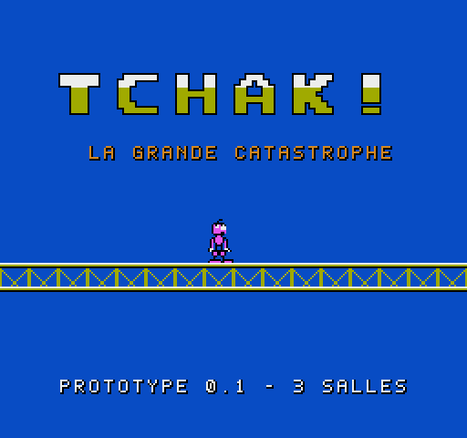
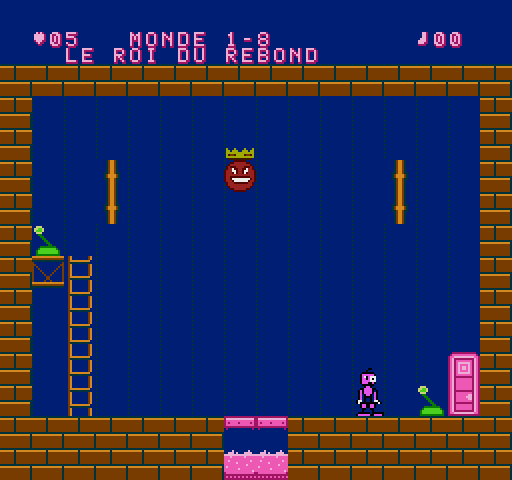

# TCHAK ! – La Grande Catastrophe

Jeu de réflexion et de réactions en chaîne pour **Nintendo NES** (8 bits, esthétique 1992).
Vous êtes BIDULE, une créature qui ne sait pas sauter mais qui sait faire **TCHAK !** : une contraction brutale qui secoue tout autour de lui… et déclenche des catastrophes en cascade.

 

## État : version 0.4 – Mondes 1 et 2 complets (16 salles + 2 boss), cartouche MMC1

Le prototype de 3 salles a validé la mécanique (§22) ; le **Monde 1 – La Fabrique des choses molles** est maintenant complet : 8 salles de difficulté croissante et le boss, le Roi du Rebond.

Ce qui est programmé et testé :

- ROM iNES **MMC1** (128 Ko PRG + 16 Ko CHR) : `dist/tchak.nes`
- BIDULE avec ses 13 types d'animation, le TCHAK, échelles, ressorts, convoyeurs, cibles, plaques, leviers, cuves de gelée, portes
- Système d'objets générique (balle, caisse, chaussette) et un ennemi (le Trouillard)
- Réactions en chaîne avec délai visible et protection contre les boucles infinies
- Monde 1 complet : 8 salles de difficulté croissante (dans chacune, le geste évident échoue et la solution demande de comprendre une règle), 3 chaussettes secrètes, et le **boss : le Roi du Rebond** (3 phases)
- Écran titre avec logo animé, menu, mot de passe, présentation du monde, pause, fin de partie, écran de fin
- Moteur son APU : 6 musiques originales (dont le thème du boss), 13 bruitages
- 25 tests automatiques sous émulateur (tous réussis), dont un « joueur qui appuie au hasard » qui ne résout aucune des 8 salles

- **Monde 2 – La maison qui n'en fait qu'à sa tête** : les meubles ont des humeurs (fauteuil grognon, lampe curieuse, commode paresseuse, coffre gourmand), 8 salles, boss **Madame Armoire**

Pas encore fait : les mondes 3 à 5 (24 salles, 3 boss).

## Jouer

Ouvrez `dist/tchak.nes` dans un émulateur NES. Commandes : croix = marcher / échelles, **B = TCHAK**, A = levier, START = pause, SELECT = recommencer la salle. Voir le [manuel](docs/MANUEL.md).

## Compiler

```sh
sudo apt-get install cc65        # ca65, cc65, ld65
pip install pillow cynes         # outils graphiques + émulateur des tests
make                             # -> build/tchak.nes
make test                        # 25 tests automatiques (~5 min)
make dist                        # copie la ROM dans dist/
```

## Organisation

| Dossier | Contenu |
|---|---|
| `src/` | code du jeu : C (cc65) + assembleur 6502 (ca65) |
| `rooms/` | salles en texte (carte, objets, déclencheurs) |
| `tools/` | générateurs : graphismes (`gfx.py`, `art_bidule.py`), salles (`rooms.py`), musique (`music.py`) |
| `tests/` | banc de test sous émulateur |
| `cfg/` | carte mémoire de l'éditeur de liens |
| `docs/` | cahier des charges, [architecture](docs/ARCHITECTURE.md), [conception](docs/GAME_DESIGN.md), [manuel](docs/MANUEL.md), [rapport de tests](docs/RAPPORT_TESTS.md) |
