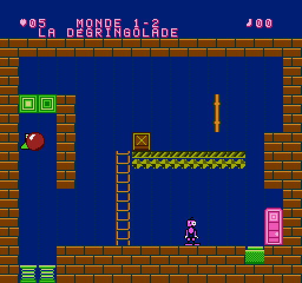
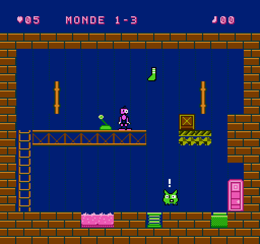

# TCHAK ! – Document de conception (préproduction + prototype)

## 1. BIDULE

Créature rose, petite tête à **un œil minuscule et un œil énorme** (asymétrie permanente, air étonné), mèche en tire-bouchon, bras qui pendent jusqu'aux genoux avec des gants blancs, genoux énormes, pieds ridicules. Sprite 16 × 24 (2 × 3 sprites).

**BIDULE ne sait pas sauter** : c'est le cœur du personnage (ses genoux sont trop gros) et ce qui rend le TCHAK indispensable. Pour monter, il prend les échelles ou se fait projeter par les ressorts. Il traverse les objets (il passe « devant »), mais peut se tenir debout sur une caisse.

| # | Animation (§4.3) | Quand |
|---|---|---|
| 1 | Immobile | au repos |
| 2 | Marche | direction maintenue |
| 3 | Déplacement rapide | direction maintenue plus de ¾ s (course, bras qui moulinent) |
| 4 | Observation | 2,5 s sans rien faire : il regarde en l'air, à gauche, à droite |
| 5 | Préparation du TCHAK | genoux pliés vers l'extérieur |
| 6 | Contraction | roulé en boule, yeux plissés |
| 7 | Déclenchement | bras et jambes écartés au maximum, yeux exorbités |
| 8 | Recul | il part en arrière, étourdi |
| 9 | Surprise | un mécanisme réagit : bras en l'air et « ! » |
| 10 | Chute | bras levés, jambes en ciseaux |
| 11 | Victoire | petits bonds, bras levés |
| 12 | Défaite | aplati dans la gelée, il s'enfonce |
| 13 | Réaction humoristique | la balle lui retombe sur la tête : écrasé, étoiles qui tournent ; grosse chute : il s'affaisse un instant |

## 2. Le TCHAK

Commande : **B**. Durée totale 24 trames (0,4 s) : préparation (4) → contraction (5) → **onde** → bras écartés (5) → recul (10). En l'air, BIDULE « plane » pendant la contraction : c'est voulu (on peut faire TCHAK au sommet d'un rebond de ressort).

Règles (fixes, découvrables, sans hasard) :

1. **Zone de choc** : 40 px de part et d'autre de BIDULE, 28 px en hauteur. Les objets dedans sont **repoussés à l'opposé de BIDULE** ; plus ils sont près, plus ils partent vite. Objet exactement au-dessus/au-dessous : il part dans la direction du regard.
2. **Monde 1 = monde élastique** : chaque objet reçoit aussi un coup vers le haut (la balle saute haut, la caisse fait un petit bond).
3. **Zone de bruit** (80 × 96 px) : plus large que la zone de choc ; les créatures qui l'entendent réagissent selon leur caractère (le Trouillard s'enfuit à l'opposé).
4. Le TCHAK ne touche **jamais** directement les mécanismes : ce sont les objets (et les créatures) qui les actionnent. BIDULE déclenche, il ne contrôle pas la suite.
5. Hors de portée, il ne se passe rien (test `t03`) : le joueur apprend la distance.

Effets : bruit « tch-AK » (souffle de bruit + note qui chute), onde en 4 quarts de cercle, tremblement de l'écran, objets qui se déforment.

## 3. Éléments du Monde 1 – La Fabrique des choses molles

| Élément | Règle |
|---|---|
| Balle molle | légère (poids 1), très élastique, rebondit sur tout ; trop légère pour une plaque à elle seule |
| Caisse | lourde (poids 3), glisse puis s'arrête, se pose ; BIDULE peut monter dessus |
| Ressort | projette **verticalement** tout ce qui tombe dessus (vitesse horizontale absorbée), BIDULE compris |
| Convoyeur | transporte ce qui est posé dessus ; arrêté / vers la droite / vers la gauche selon les déclencheurs |
| Cible murale | s'allume quand un objet la percute assez vite (aussi par-dessous ou par-dessus) |
| Plaque | enfoncée par un poids ≥ 2 ; relâchée dès qu'il n'y a plus assez de poids (porte « tenue ») |
| Levier | BIDULE l'actionne avec **A** ; alterne ON / OFF |
| Échelle | HAUT/BAS ; son sommet est un plancher |
| Cuve de gelée | BIDULE y perd une vie ; un objet y disparaît (« plouf ») et réapparaît à sa place |
| Porte mécanique | fermée = mur ; ouverte = sortie de la salle |
| Chaussette | bonus caché ou difficile d'accès (une par salle au plus) |

Poids de BIDULE : **1**. Il ne peut donc pas tenir une plaque seul (« BIDULE est tout maigre ») — mais BIDULE + la balle, oui.

### Ennemi : le Trouillard

Petite boule verte à grandes oreilles. **Dort** (« Zz ») → un bruit ou un choc l'**effraie** (« ! », petit bond, cri) → il **court** tout droit à l'opposé du bruit à 1,25 px/trame, en poussant tout sur son passage (y compris sur les plaques) → arrêté par un mur ou bloqué, il **s'essouffle** puis se rendort sur place. Il est inoffensif pour BIDULE mais peut tomber dans la gelée (il réapparaît alors endormi chez lui). Comportement prévisible après une observation : c'est un outil autant qu'un obstacle.

## 4. Fiches des 3 salles du prototype (§8)

Dimensions : 16 × 13 cases de 16 px (256 × 208 px) sous un bandeau de 32 px. Échec possible partout : SELECT recommence la salle sans perte de vie.

### Salle 1-1 « PREMIER TCHAK ! » – salle simple / introduction

- **Objectif** : ouvrir la porte (à gauche) et sortir.
- **Disposition** : BIDULE au centre-gauche, une balle juste à sa droite, un petit bloc rose au sol, une grande cible verte (2 cases) sur le mur de droite, la porte à gauche.
- **Mécanique** : le TCHAK repousse les objets à l'opposé.
- **Solution** : TCHAK à côté de la balle → elle saute par-dessus le bloc et percute la cible → la porte s'ouvre (BIDULE sursaute) → marcher à gauche.
- **Ce que le joueur apprend** : la portée (trop loin = rien), le sens de la poussée (se mettre à droite de la balle l'envoie… dans la porte fermée).
- **Échec** : aucun ; la balle peut être relancée autant qu'on veut.

### Salle 1-2 « LA DÉGRINGOLADE » – réaction en chaîne

- **Objectif** : ouvrir la porte de droite.
- **Disposition** : à gauche un puits à 2 ressorts sous une colonne fermée par deux cibles au plafond ; au centre une échelle mène à un convoyeur (arrêté) qui porte une caisse ; une plaque au pied de la porte ; BIDULE à droite, la balle à sa gauche.
- **Chaîne principale** : TCHAK → la balle file à gauche, tombe dans le puits → le ressort la projette à la verticale → elle frappe les cibles → le convoyeur démarre → la caisse avance, bute sur le pilier et tombe sur la plaque → la porte s'ouvre et reste ouverte (la caisse pèse 3). La balle continue de rebondir dans le puits : une petite machine perpétuelle (sans danger, voir garde-fous).
- **Solution alternative** : monter à l'échelle, se placer derrière la caisse et la pousser à coups de TCHAK sur le convoyeur arrêté jusqu'à ce qu'elle tombe.
- **Secret** : sauter soi-même dans le puits → BIDULE est catapulté dans la colonne et attrape la **chaussette** ; il en ressort en se dirigeant vers la droite pendant un rebond.
- **Échec** : aucun mortel ; une caisse mal poussée reste sur le convoyeur (on recommence à pousser, ou on relance la balle).

### Salle 1-3 « TROIS FAÇONS DE SORTIR » – plusieurs solutions

- **Objectif** : maintenir enfoncée la plaque devant la porte (poids ≥ 2).
- **Disposition** : cuve de gelée au sol entre BIDULE et le reste de la salle ; échelle à gauche vers une passerelle avec un levier ; un ressort au sol au bout de la passerelle ; un Trouillard endormi à droite ; une étagère-convoyeur avec une caisse au-dessus d'un trou ; une chaussette en hauteur au-dessus du ressort.
- **Solution 1 (le Trouillard)** : depuis le bout de la passerelle, TCHAK → il entend, fuit vers la droite, bute contre la porte et s'endort… sur la plaque.
- **Solution 2 (le levier)** : A sur le levier → l'étagère se met en marche → la caisse tombe dans le trou, sur la plaque.
- **Solution 3 (le ressort)** : descendre de la passerelle sur le ressort, se diriger pendant le vol pour atterrir sur la caisse, TCHAK → elle file, bute contre le pilier et tombe sur la plaque.
- **Secret** : en rebondissant tout droit sur le ressort, BIDULE attrape la **chaussette**.
- **Échec** : marcher dans la cuve (perte d'une vie) ; faire TCHAK en étant à droite du Trouillard l'envoie à gauche… dans la gelée (il réapparaît endormi).
- **À observer** : BIDULE seul sur la plaque ne suffit pas (poids 1).

## 5. Plan de la suite (40 salles, 5 boss)

Chaque monde reprendra la répartition du §8 (introduction, apprentissage, découverte, combinaison, intermédiaire, plusieurs solutions, complexe, boss). Les 3 salles du prototype deviendront les salles 1-1, 1-4 et 1-6 du jeu final ; les nouvelles mécaniques prévues :

| Monde | Règle du TCHAK | Nouveaux éléments prévus | Boss (énigme) |
|---|---|---|---|
| 1 Fabrique | pousse + rebond | trappes, cuves, tuyaux qui recrachent | **Roi du Rebond** : il rebondit partout ; le faire tomber sur le ressort sous un plafond de pointes molles en orientant ses rebonds avec des caisses |
| 2 Maison | effraie / vexe / réveille selon l'humeur | meubles peureux, paresseux, colériques, gourmands | **Madame Armoire** : elle avale ce qui l'approche et le recrache par une autre porte ; lui faire avaler la bonne chose au bon moment |
| 3 Usine | met en marche / arrête les machines | engrenages, pistons, interrupteurs multiples, ordre des réactions | **Le Grand Dérangé** : il inverse les machines ; retourner ses propres pistons contre lui |
| 4 Travers | inverse la gravité locale | objets qui montent, convoyeurs inversés, plafonds-planchers | **Le Roi à l'Envers** : son comportement suit la gravité de la zone où il se trouve |
| 5 Bazar | combinaison | toutes les règles, zones de règles différentes dans une même salle | **Le Maître du Chaos** : il change les propriétés des objets ; grande énigme en plusieurs tableaux |
