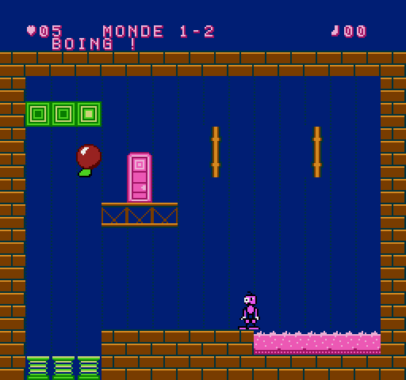
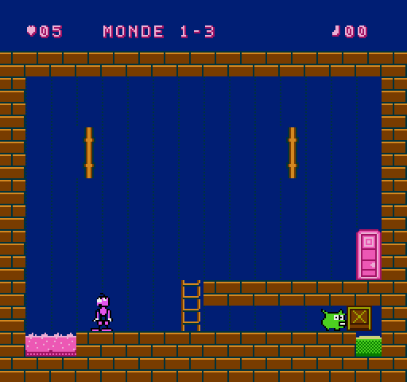
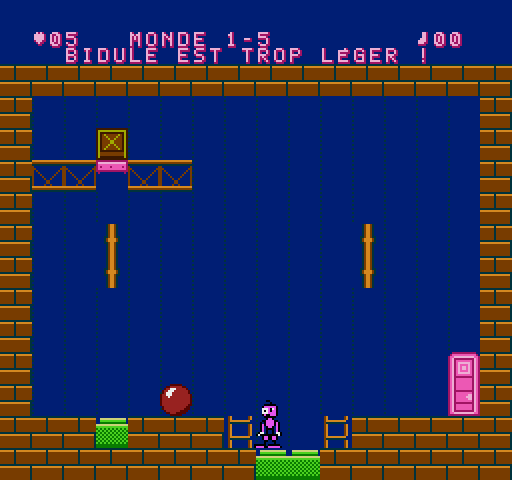
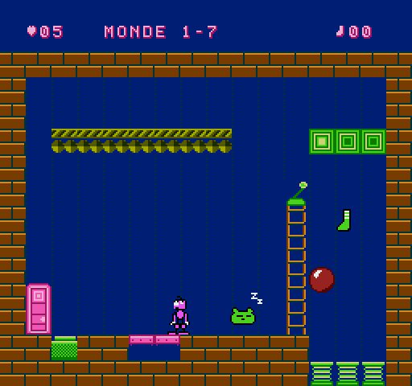
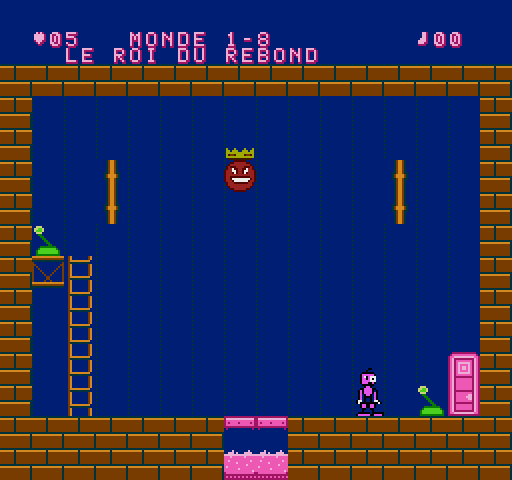

# TCHAK ! – Document de conception (préproduction + prototype)

## 1. BIDULE

Créature rose, petite tête à **un œil minuscule et un œil énorme** (asymétrie permanente, air étonné), mèche en tire-bouchon, bras qui pendent jusqu'aux genoux avec des gants blancs, genoux énormes, pieds ridicules. Sprite 16 × 24 (2 × 3 sprites).

**BIDULE ne sait pas sauter** : c'est le cœur du personnage (ses genoux sont trop gros) et ce qui rend le TCHAK indispensable. Pour monter, il prend les échelles ou se fait projeter par les ressorts. Il traverse les objets (il passe « devant »), mais peut se tenir debout sur une caisse.

| # | Animation (§4.3) | Quand |
|---|---|---|
| 1 | Immobile | au repos |
| 2 | Marche | direction maintenue |
| 3 | Déplacement rapide | direction maintenue plus de ¾ s (course, bras qui moulinent) |
| 4 | Observation | 2,5 s sans rien faire : il regarde en l'air, à gauche, à droite |
| 5 | Préparation du TCHAK | genoux pliés vers l'extérieur |
| 6 | Contraction | roulé en boule, yeux plissés |
| 7 | Déclenchement | bras et jambes écartés au maximum, yeux exorbités |
| 8 | Recul | il part en arrière, étourdi |
| 9 | Surprise | un mécanisme réagit : bras en l'air et « ! » |
| 10 | Chute | bras levés, jambes en ciseaux |
| 11 | Victoire | petits bonds, bras levés |
| 12 | Défaite | aplati dans la gelée, il s'enfonce |
| 13 | Réaction humoristique | la balle lui retombe sur la tête : écrasé, étoiles qui tournent ; grosse chute : il s'affaisse un instant |

## 2. Le TCHAK

Commande : **B**. Durée totale 24 trames (0,4 s) : préparation (4) → contraction (5) → **onde** → bras écartés (5) → recul (10). En l'air, BIDULE « plane » pendant la contraction : c'est voulu (on peut faire TCHAK au sommet d'un rebond de ressort).

Règles (fixes, découvrables, sans hasard) :

1. **Zone de choc** : 40 px de part et d'autre de BIDULE, 28 px en hauteur. Les objets dedans sont **repoussés à l'opposé de BIDULE** ; plus ils sont près, plus ils partent vite. Objet exactement au-dessus/au-dessous : il part dans la direction du regard.
2. **Monde 1 = monde élastique** : chaque objet reçoit aussi un coup vers le haut (la balle saute haut, la caisse fait un petit bond).
3. **Zone de bruit** (80 × 96 px) : plus large que la zone de choc ; les créatures qui l'entendent réagissent selon leur caractère (le Trouillard s'enfuit à l'opposé).
4. Le TCHAK ne touche **jamais** directement les mécanismes : ce sont les objets (et les créatures) qui les actionnent. BIDULE déclenche, il ne contrôle pas la suite.
5. Hors de portée, il ne se passe rien (test `t03`) : le joueur apprend la distance.

Effets : bruit « tch-AK » (souffle de bruit + note qui chute), onde en 4 quarts de cercle, tremblement de l'écran, objets qui se déforment.

## 3. Éléments du Monde 1 – La Fabrique des choses molles

| Élément | Règle |
|---|---|
| Balle molle | légère (poids 1), très élastique, rebondit sur tout ; trop légère pour une plaque à elle seule |
| Caisse | lourde (poids 3), glisse puis s'arrête, se pose ; BIDULE peut monter dessus |
| Ressort | projette **verticalement** tout ce qui tombe dessus (vitesse horizontale absorbée), BIDULE compris |
| Convoyeur | transporte ce qui est posé dessus ; arrêté / vers la droite / vers la gauche selon les déclencheurs |
| Cible murale | s'allume quand un objet la percute assez vite (aussi par-dessous ou par-dessus) |
| Plaque | enfoncée par un poids ≥ 2 ; relâchée dès qu'il n'y a plus assez de poids (porte « tenue ») |
| Levier | BIDULE l'actionne avec **A** ; alterne ON / OFF |
| Échelle | HAUT/BAS ; son sommet est un plancher |
| Cuve de gelée | BIDULE y perd une vie ; un objet y disparaît (« plouf ») et réapparaît à sa place |
| Porte mécanique | fermée = mur ; ouverte = sortie de la salle |
| Chaussette | bonus caché ou difficile d'accès (une par salle au plus) |

Poids de BIDULE : **1**. Il ne peut donc pas tenir une plaque seul (« BIDULE est tout maigre ») — mais BIDULE + la balle, oui.

### Ennemi : le Trouillard

Petite boule verte à grandes oreilles. **Dort** (« Zz ») → un bruit ou un choc l'**effraie** (« ! », petit bond, cri) → il **court** tout droit à l'opposé du bruit à 1,25 px/trame, en poussant tout sur son passage (y compris sur les plaques) → arrêté par un mur ou bloqué, il **s'essouffle** puis se rendort sur place. Il est inoffensif pour BIDULE mais peut tomber dans la gelée (il réapparaît alors endormi chez lui). Comportement prévisible après une observation : c'est un outil autant qu'un obstacle.

## 4. Fiches des 8 salles du Monde 1 (§8)

Dimensions : 16 × 13 cases de 16 px (256 × 208 px) sous un bandeau de 32 px. Échec possible partout : SELECT recommence la salle sans perte de vie.

**Principe de conception (version 0.2)** : dans chaque salle, **le geste évident échoue**, de façon visible et sans bloquer la partie (l'objet tombe dans la gelée et revient, la caisse continue de rebondir…). La solution demande d'avoir compris une règle. C'est vérifié par un test : un « joueur qui appuie au hasard » ne résout aucune des 8 salles (6 parties de 20 s par salle).

Progression de la difficulté : 1-1 sens de la poussée → 1-2 ressort vertical → 1-3 fuite du Trouillard → 1-4 TCHAK au vol (timing) → 1-5 poids (BIDULE + balle) → 1-6 ordre des actions, 3 solutions → 1-7 tout combiné en 3 étapes → 1-8 boss.

### Salle 1-1 « PREMIER TCHAK ! » – introduction : le sens de la poussée

- **Objectif** : ouvrir la porte, en haut à gauche, sur une corniche accessible par une échelle.
- **Disposition** : BIDULE part **à gauche** de la balle ; à droite, une cuve de gelée ; sur le mur de gauche, une grande cible verte (4 cases).
- **Piège** : le TCHAK réflexe envoie la balle à droite… dans la gelée (« plouf », elle revient à sa place).
- **Règle à comprendre** : le TCHAK repousse **à l'opposé** de BIDULE. Il faut passer de l'autre côté de la balle (attention à la gelée juste derrière) avant de faire TCHAK.
- **Solution** : se placer entre la balle et la cuve, TCHAK → la balle file à gauche et frappe la cible → la porte s'ouvre → échelle → corniche → sortie.
- **Échec** : marcher dans la cuve (perte d'une vie).

### Salle 1-2 « BOING ! » – apprentissage : le ressort renvoie à la verticale

- **Objectif** : ouvrir la porte posée sur une corniche, en haut à gauche.
- **Disposition** : un puits de 3 ressorts contre le mur de gauche, sous 3 cibles suspendues ; la balle au milieu ; une grande cuve de gelée à droite.
- **Piège** : TCHAK réflexe (BIDULE est à gauche de la balle) → la balle part dans la gelée.
- **Solution** : passer à droite de la balle (sans reculer dans la gelée : le recul du TCHAK fait faire un petit pas en arrière !), TCHAK → la balle file contre le mur, tombe dans le puits, le ressort la projette tout droit dans les cibles → la porte s'ouvre. BIDULE saute alors lui-même dans le puits et se dirige pendant le vol pour atterrir sur la corniche.
- **Secret** : la **chaussette** au-dessus de la corniche, sur la trajectoire du vol.

### Salle 1-3 « LE TUNNEL DU TROUILLARD » – découverte : la fuite du Trouillard

- **Objectif** : pousser la caisse au fond d'un tunnel, sur la plaque ; la porte est sur le toit du tunnel.
- **Disposition** : BIDULE commence sur le toit ; en bas, le Trouillard dort à l'entrée du tunnel ; une cuve à gauche ; le tunnel ne fait que 16 px de haut : **BIDULE n'y entre pas**, le Trouillard si.
- **Piège** : un TCHAK depuis le toit (à droite du Trouillard) le fait fuir à gauche, dans la gelée.
- **Solution** : descendre, se glisser entre la cuve et le Trouillard, TCHAK → il fonce dans le tunnel et pousse la caisse jusqu'à la plaque. Remonter par l'échelle jusqu'à la porte.

### Salle 1-4 « LA DÉGRINGOLADE » – réaction en chaîne et timing

- **Objectif** : poser la caisse sur la plaque, sur l'étagère en haut à gauche (la porte est en bas à droite).
- **Disposition** : la caisse au sol, un ressort dans une colonne entre l'étagère (à gauche) et un petit rebord (à droite) desservi par une échelle.
- **Étape 1** : pousser la caisse sur le ressort. Elle rebondit alors indéfiniment… **à la verticale** : le ressort absorbe la vitesse horizontale et recentre l'objet. Elle ne tombera jamais toute seule sur l'étagère.
- **Étape 2** : monter sur le rebord et faire TCHAK **au moment où la caisse passe devant BIDULE** (fenêtre d'environ 8 trames à la montée comme à la descente ; le TCHAK part 9 trames après l'appui, il faut anticiper). Poussée vers la gauche, elle atterrit sur l'étagère et glisse jusqu'à la plaque.
- **Pièges** : TCHAK trop tôt ou trop tard → rien ne se passe, ou la caisse retombe à côté de la plaque. Si elle s'arrête trop tôt sur l'étagère, BIDULE peut monter par le ressort et la pousser de nouveau.
- **Secret** : BIDULE se laisse projeter seul par le ressort, tout droit, et attrape la **chaussette** au plafond.

### Salle 1-5 « POIDS PLUME » – intermédiaire : BIDULE pèse 1

- **Objectif** : faire tomber la caisse (posée sur une trappe, en haut) sur la plaque qui ouvre la porte.
- **Disposition** : une cuvette avec deux plaques et deux échelles ; la trappe s'ouvre quand la cuvette porte un poids de 2.
- **Piège** : BIDULE seul dans la cuvette → rien (message « BIDULE EST TROP LÉGER ! »). BIDULE + balle sur la plaque d'en bas → la porte s'ouvre… et se referme dès qu'il en descend.
- **Solution** : ressortir par l'échelle de gauche, pousser la balle dans la cuvette, y redescendre : 1 + 1 = 2 → la trappe s'ouvre, la caisse tombe sur l'autre plaque, la porte reste ouverte.

### Salle 1-6 « TROIS FAÇONS DE SORTIR » – ordre des actions, plusieurs solutions

- **Objectif** : tenir enfoncée la plaque devant la porte (à gauche, poids ≥ 2).
- **Disposition** : BIDULE à droite, un Trouillard endormi au milieu, une cuve de gelée entre lui et la porte ; en haut, une plate-forme avec une caisse, et un levier au sommet de l'échelle de droite (assez loin pour que le Trouillard n'entende rien).
- **Piège** : le TCHAK réflexe réveille le Trouillard, qui fuit tout droit… dans la cuve (il réapparaît endormi).
- **Règle à comprendre** : le levier fait tomber une **planche sur la cuve**. Il faut actionner le levier **avant** d'effrayer quoi que ce soit (sans planche, BIDULE lui-même ne peut pas atteindre la porte).
- **Solution 1** : levier, puis TCHAK près du Trouillard, depuis sa droite → il traverse la planche, bute contre la porte et s'endort sur la plaque.
- **Solution 2** : levier, puis TCHAK sur la caisse depuis la plate-forme → la caisse tombe ; le Trouillard, effrayé par le bruit (ou par la caisse qui lui tombe dessus), part vers la plaque et la pousse devant lui.
- **Solution 3** : levier, puis pousser la caisse au sol à coups de TCHAK jusqu'à la plaque (sans s'approcher du Trouillard, ou en l'envoyant d'abord dormir contre la porte).
- **À observer** : BIDULE seul sur la plaque ne suffit pas (poids 1).

### Salle 1-7 « LA GRANDE MACHINE » – complexe : trois étapes

- **Objectif** : amener le Trouillard, endormi tout en haut sur un convoyeur arrêté, jusqu'à la plaque près de la porte, de l'autre côté d'une cuve.
- **Étapes** (dans un ordre à trouver) : 1) le levier (en haut de l'échelle) pose une planche sur la cuve ; 2) depuis la gauche de la balle, TCHAK → elle file dans le puits de droite, le ressort la projette dans les cibles → le convoyeur démarre → le Trouillard est emporté et tombe au sol ; 3) l'effrayer **depuis sa droite** → il traverse la planche et s'endort sur la plaque.
- **Pièges** : la balle poussée vers la gauche ; effrayer le Trouillard avant d'avoir posé la planche (il tombe dans la gelée et réapparaît en haut, sur le convoyeur, qui le ramène).
- **Secret** : une **chaussette** sur la trajectoire de BIDULE quand il se laisse projeter par le ressort.

### Salle 1-8 « LE ROI DU REBOND » – boss

- **Le Roi** : boule rose couronnée, trop lourde pour être arrêtée. Il bondit sans fin ; s'il retombe sur BIDULE, celui-ci est aplati et étourdi (pas de vie perdue, mais il ne peut plus rien faire pendant ¾ s).
- **La salle** : au centre du sol, une trappe de 2 cases au-dessus d'une cuve. Deux leviers (un sur une corniche à gauche, un au sol à droite) l'ouvrent **pendant 0,8 s seulement**.
- **Phases** (comportements différents) :
  1. il bondit d'un mur à l'autre (bonds courts) ;
  2. il bondit plus haut et plus vite ;
  3. furieux (il change d'expression), **il vise BIDULE** à chaque bond.
- **Solution** : observer la trajectoire et actionner le levier juste avant qu'il retombe sur la trappe. En phase 3, se servir de soi-même comme appât depuis le levier de droite : il bondit vers BIDULE et passe au-dessus de la trappe. Le TCHAK peut dévier un bond (il lui donne une nouvelle direction).
- **Échecs** : attendre ne sert à rien (test : 30 s sans levier, il ne tombe jamais) ; ouvrir trop tôt ou trop tard, la trappe se referme ; tomber soi-même dans la trappe ouverte.
- **Victoire** : à la 3e chute, il reste au fond (« LE ROI EST DÉGONFLÉ ! »), sa couronne reste au bord de la cuve en scintillant, la trappe se referme et la porte s'ouvre.

## 5. Monde 2 – La maison qui n'en fait qu'à sa tête

**Nouvelle règle** : le TCHAK ne pousse plus les meubles, il les fait réagir selon leur **humeur**. Toutes les réactions sont fixes et lisibles (bulles « Zz », « ! », étoiles d'agacement).

| Meuble | Humeur | Réaction | Poids |
|---|---|---|---|
| Fauteuil grognon | colérique | entend le TCHAK (112 px) → fonce **vers** BIDULE jusqu'au premier obstacle, pousse tout, aplatit BIDULE au passage | 3 |
| Lampe curieuse | curieuse | entend le TCHAK (128 px) → va se placer **exactement là où BIDULE a fait TCHAK** (elle peut tomber d'une étagère en chemin) | 2 |
| Commode paresseuse | paresseuse | 1er TCHAK : une étoile ; 2e : deux étoiles ; **au 3e** (l'agacement retombe d'un cran toutes les 1,5 s), elle s'enfuit à l'opposé jusqu'au premier obstacle | 3 |
| Coffre gourmand | gourmand | ignore le TCHAK ; marche vers le biscuit le plus proche **à son étage** et le mange là où il est (un nouveau biscuit réapparaît ensuite) | 3 |
| Biscuit | – | objet léger, poussé par le TCHAK | 1 |

**Serrures** : une plaque ou une cible marquée « serrure » ne compte qu'une fois (elle devient un bloc) ; la porte s'ouvre à la troisième.

| Salle | Ce qu'il faut comprendre | Le réflexe qui échoue |
|---|---|---|
| 2-1 Le fauteuil grognon | il fonce **vers** le bruit : se placer derrière la plaque | descendre côté gauche : il plonge dans la gelée |
| 2-2 La lampe curieuse | faire TCHAK **sur** la plaque pour l'y attirer | TCHAK au départ : elle vient… à côté de BIDULE |
| 2-3 La commode qui dort | insister (3 TCHAK) **et** se placer du bon côté | un seul TCHAK : rien ; du mauvais côté : la gelée |
| 2-4 Le coffre à biscuits | doser la poussée du biscuit pour que le coffre le mange **sur** la plaque | trop fort ou trop faible : il le mange à côté (un autre biscuit revient) |
| 2-5 Les trois serrures | une serrure par humeur : commode, fauteuil (bloqué par un pilier), lampe | — |
| 2-6 Un coupable au choix | plusieurs solutions : la commode seule, ou le fauteuil qui la pousse jusqu'à la plaque | TCHAK au départ : le fauteuil fonce contre le mur |
| 2-7 Le grand ménage | un seul TCHAK bien placé attire la lampe **et** lance le fauteuil ; poser la planche **avant** de chasser la commode | ordre inversé : la commode plonge dans la gelée |
| 2-8 **Madame Armoire** (boss) | elle n'avale que ce qu'on lui **lance** et le recrache par-dessus elle, vers l'arrière : viser les 3 serrures du plafond en choisissant le moment (un TCHAK proche la retourne) ; elle accélère à chaque serrure | attendre : elle ne fait que pousser les biscuits |

Boss mesuré : avec le solveur automatique (on lance un biscuit à des moments différents), 62 % des lancers ouvrent la 1re serrure, 20 % la 2e, 15 % la 3e. Sans intervention, 0 serrure en 30 s.

## 6. Monde 3 – L'usine des catastrophes

**Règle du monde** : les réactions en chaîne à plusieurs étages ; il faut comprendre **l'ordre** des événements.

| Élément | Comportement |
|---|---|
| Piston | fixe (les objets butent dessus) ; une action `WORLD n` (cible, plaque, levier) le fait frapper : ce qui est juste devant lui est projeté |
| Le Copieur | reproduit le **déplacement réel** de BIDULE (pousser contre un mur ne le fait pas avancer) ; un TCHAK (96 px) le passe en **miroir** et inversement |
| Le Machinal | patrouille, fait demi-tour aux murs et au bord des trous, appuie sur les plaques au passage ; un TCHAK le fige 2,5 s puis il repart dans l'autre sens |
| Le Grand Dérangé (boss) | patrouille sans jamais tomber, **inverse les convoyeurs** toutes les 4 s / 3 s / 2,3 s selon la phase, aplatit BIDULE ; un TCHAK proche l'étourdit (1,5 s → 0,9 s) et le convoyeur l'emporte |

| Salle | Ce qu'il faut comprendre | Le réflexe qui échoue |
|---|---|---|
| 3-1 Le piston | balle → cible → piston → caisse → plaque | la balle poussée du mauvais côté finit dans la gelée |
| 3-2 Le Copieur | il copie vos pas : le mettre en miroir **avant** de marcher vers la porte | marcher tout droit : il tombe de son étage |
| 3-3 Le Machinal | la plaque ne pose la passerelle que pendant qu'on appuie : le figer **sur** la plaque | attendre son passage : la passerelle disparaît sous vos pieds |
| 3-4 La chaîne de montage | la balle inverse le convoyeur (chaque coup l'inverse à nouveau !), la caisse tombe devant le piston, **puis** le levier | levier trop tôt : le piston frappe dans le vide |
| 3-5 Copie conforme | enfermé dans une cage : aller-retour + miroir à chaque demi-tour (cliquet) | pousser contre le mur : le Copieur ne bouge pas |
| 3-6 Deux façons de pousser | le piston (levier en haut) ou se glisser contre le piston et pousser soi-même | — |
| 3-7 La grande chaîne | trois serrures (cible, piston/caisse, Copieur) ; chaque TCHAK fait aussi basculer le Copieur | TCHAK à tort et à travers : le Copieur part dans le mauvais sens |
| 3-8 **Le Grand Dérangé** | l'étourdir près d'un trou **quand le convoyeur y va** ; 3 chutes | rester immobile : le convoyeur vous emporte dans la gelée |

## 7. Monde 4 – Le monde qui marche de travers

**Règle du monde** : la gravité des **objets** peut s'inverser (levier ou cible : action `WORLD 9`). Un objet qui « tombe vers le haut » se pose au plafond et peut y enfoncer des plaques ou toucher des cibles. BIDULE n'est pas concerné. Le TCHAK pousse toujours « loin du sol » de l'objet (vers le bas pour un objet au plafond).

| Élément | Comportement |
|---|---|
| Ballon | tombe toujours à l'envers du reste du monde ; léger (poids 1), peu de glisse |
| Aimant | fixe ; allumé (`WORLD n`), il attire horizontalement **toutes** les caisses de la salle, au sol comme au plafond, jusqu'à sa colonne |
| Le Roi à l'Envers (boss) | marche vers BIDULE sur le sol ou au plafond, ne marche jamais dans un trou ; en phases 2-3 il retourne lui-même la gravité ; il ne tombe dans une cuve (du plafond ou du sol) que si la gravité s'inverse quand il est dessous / dessus |

| Salle | Ce qu'il faut comprendre | Le réflexe qui échoue |
|---|---|---|
| 4-1 La tête en bas | placer la caisse **sous** la plaque du plafond avant d'inverser | inverser tout de suite : la caisse se colle au plafond à côté |
| 4-2 Le ballon | inverser pour que le ballon descende, le pousser sous la cheminée, revenir à la normale | — (il est hors de portée au plafond) |
| 4-3 L'aimant | l'aimant seul bloque la caisse contre l'obstacle : passer par le plafond | allumer l'aimant et attendre |
| 4-4 Trois serrures à l'envers | plaque du sol, puis plaque du plafond, puis ballon : l'ordre des retournements compte | inverser trop tôt : la caisse et le ballon partent au mauvais endroit |
| 4-5 Zigzag | deux colonnes, une au sol et une au plafond : aimant (en haut de l'échelle) + deux retournements au bon moment | retourner au hasard |
| 4-6 Par-dessus le trou | l'aimant seul fait tomber la caisse dans la cuve : passer par le plafond | allumer l'aimant d'abord |
| 4-7 Le grand retournement | zigzag + ballon à glisser sous la cheminée entre deux retournements + deux plaques | — |
| 4-8 **Le Roi à l'Envers** | il vient vers vous : rester près du levier et retourner la gravité quand il passe sous le trou du plafond, ou au-dessus de celui du sol | attendre : il ne tombe jamais seul |

## 8. Monde 5 – Le Grand Bazar

**Règle du monde** : la combinaison. Les salles 5-1 à 5-4 (banque 5a) mélangent les **meubles à humeurs** du Monde 2 et la **gravité** du Monde 4 ; les salles 5-5 à 5-8 (banque 5b) mélangent les **machines** du Monde 3 et la gravité. Le monde occupe deux banques MMC1 (le code des deux mondes d'origine ne tient pas dans 8 Ko).

| Salle | Ce qu'il faut comprendre | Le réflexe qui échoue |
|---|---|---|
| 5-1 Le fauteuil tombe en l'air | retourner la gravité **puis** faire TCHAK : le fauteuil court au plafond vers BIDULE et écrase la plaque | TCHAK sans retournement : il fonce au sol |
| 5-2 La lampe au plafond | la tête en bas, la lampe vient voir là où on a fait TCHAK… sur la plaque du plafond | TCHAK au sol : elle reste par terre |
| 5-3 Le goûter à l'envers | placer le biscuit contre la porte, **puis** retourner : le coffre court au plafond, sur la plaque | retourner tout de suite : le coffre n'a rien à manger |
| 5-4 Le grand déménagement | trois serrures : commode (3 TCHAK du bon côté), fauteuil (il vient toujours vers BIDULE : l'attirer contre la butée de droite avant d'inverser), ballon sous la cible du plafond | TCHAK au départ : le fauteuil part à gauche, contre la commode |
| 5-5 Le Copieur tête en bas | au plafond, le Copieur copie vos pas, mais vous n'avez pas la place d'aller assez loin : **miroir**, puis marcher vers la porte (il recule jusqu'au mur et tient la plaque) | aller à droite : il s'arrête avant la plaque ; miroir au sol : il file dans la cuve |
| 5-6 Le tapis du chaos | le convoyeur emporte la caisse vers la cuve : grimper au levier et retourner la gravité **quand elle passe sous la plaque** (fenêtre de 0,4 s) | retourner tout de suite : la caisse se colle au plafond trop tôt |
| 5-7 La grande catastrophe | trois serrures dans le bon ordre : Copieur sur son étagère, gravité (la caisse du bas monte sur la plaque du plafond), retour, **puis** piston | le piston d'abord : il chasse la caisse de sous la plaque du plafond |
| 5-8 **Le Maître du Chaos** | trois serrures au milieu du désordre : balle poussée **doucement** dans le puits à ressorts (cible de gauche), caisse contre le piston (plaque), ballon glissé sous la cible du plafond pendant une inversion | TCHAK de près : la balle survole le puits et revient |

**Le Maître du Chaos** (boss final) flotte en haut de l'écran et lance un sort toutes les 5,5 s (4 s après une serrure, 2,8 s après deux), annoncé 1 s à l'avance par un « ! » : gravité retournée, caisses qui flottent (« LES CAISSES PERDENT LA TÊTE ! »), convoyeurs inversés. Il ne touche jamais BIDULE et ne ferme aucune serrure tout seul (mesuré sur 20 s). Vaincu, il rend la gravité normale ; l'écran final affiche « FIN DU JEU ! ».

## 9. Cohérence de la difficulté (audit de la version 1.0)

Chaque salle a été rejouée par un **joueur qui appuie au hasard** (parties de 20 s, 4 graines dans la suite de tests, 10 pendant la mise au point) : aucune des 40 salles n'est résolue ainsi. Les réglages suivants alignent la progression d'un monde à l'autre :

| Réglage | Avant | Après |
|---|---|---|
| Vies | 5 au départ, jamais rendues | au moins 5 vies au début de chaque monde (un monde difficile ne ruine plus la suite) |
| Boss 1-8 (le premier) | trappe ouverte 0,8 s | 80 trames (1,3 s) : le premier boss reste le plus tolérant |
| Boss 4-8 | Roi à l'Envers plus lent que les autres boss | vitesses 14 / 22 / 28 selon la phase |
| 3-6 | une seule bonne idée, trouvable par hasard | refaite avec deux solutions qui demandent chacune une règle (plaque du robot ajoutée) |
| 4-5 / 4-6 | ordre inversé par rapport à la difficulté | permutées (la plus simple d'abord) |
| Monde 5 | — | salles basses quand un meuble doit entendre du plafond, leviers sur des corniches quand le hasard suffisait |

Fenêtres de réussite des boss (part des instants où l'action décisive réussit, mesurée par balayage) :

| Boss | Phase 1 | Phase 2 | Phase 3 |
|---|---|---|---|
| 1-8 Roi du Rebond | 7 % | 16 % | 25 % (le levier de droite vise BIDULE) |
| 2-8 Madame Armoire (par lancer) | 62 % | 20 % | 15 % |
| 3-8 Grand Dérangé | il faut l'étourdir près d'un trou quand le convoyeur y va | | |
| 4-8 Roi à l'Envers | 4 % | 8 % | 7 % |
| 5-8 Maître du Chaos | trois actions précises, sorts de plus en plus rapprochés (5,5 s → 4 s → 2,8 s) | | |

Le principe reste celui du §2 : dans chaque salle, **le geste évident échoue**, et la solution demande d'avoir compris une règle. Le Monde 5 demande d'en combiner deux.

## 10. Bilan (40 salles, 5 boss)

Chaque monde reprendra la répartition du §8 (introduction, apprentissage, découverte, combinaison, intermédiaire, plusieurs solutions, complexe, boss). Le Monde 1 est terminé. Chaque nouvelle salle devra passer le test du « joueur qui ne comprend rien ». Nouvelles mécaniques prévues :

| Monde | Règle du TCHAK | Nouveaux éléments prévus | Boss (énigme) |
|---|---|---|---|
| 1 Fabrique | pousse + rebond | **fait** (8 salles + boss) | **Roi du Rebond** : fait (voir ci-dessus) |
| 2 Maison | réactions selon l'humeur | **fait** (8 salles + boss) | **Madame Armoire** : fait (voir ci-dessus) |
| 3 Usine | ordre des réactions | **fait** (8 salles + boss) | **Le Grand Dérangé** : fait (voir ci-dessus) |
| 4 Travers | gravité des objets inversable | **fait** (8 salles + boss) | **Le Roi à l'Envers** : fait (voir ci-dessus) |
| 5 Bazar | combinaison | **fait** (8 salles + boss, deux banques) | **Le Maître du Chaos** : fait (voir ci-dessus) |
