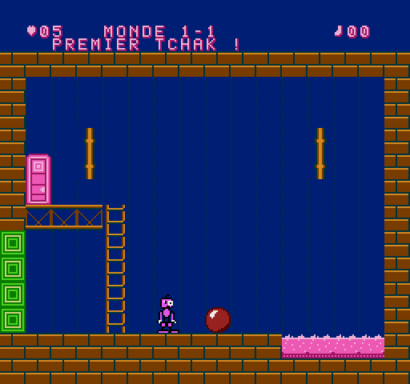
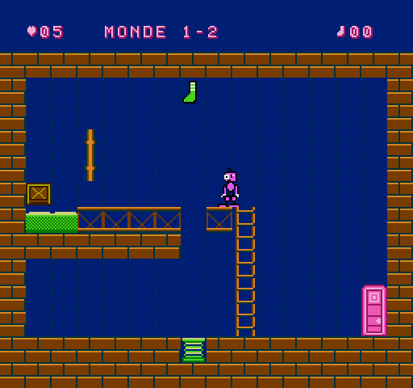
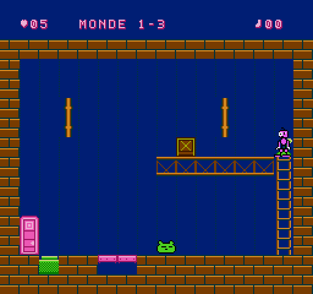

# TCHAK ! – Document de conception (préproduction + prototype)

## 1. BIDULE

Créature rose, petite tête à **un œil minuscule et un œil énorme** (asymétrie permanente, air étonné), mèche en tire-bouchon, bras qui pendent jusqu'aux genoux avec des gants blancs, genoux énormes, pieds ridicules. Sprite 16 × 24 (2 × 3 sprites).

**BIDULE ne sait pas sauter** : c'est le cœur du personnage (ses genoux sont trop gros) et ce qui rend le TCHAK indispensable. Pour monter, il prend les échelles ou se fait projeter par les ressorts. Il traverse les objets (il passe « devant »), mais peut se tenir debout sur une caisse.

| # | Animation (§4.3) | Quand |
|---|---|---|
| 1 | Immobile | au repos |
| 2 | Marche | direction maintenue |
| 3 | Déplacement rapide | direction maintenue plus de ¾ s (course, bras qui moulinent) |
| 4 | Observation | 2,5 s sans rien faire : il regarde en l'air, à gauche, à droite |
| 5 | Préparation du TCHAK | genoux pliés vers l'extérieur |
| 6 | Contraction | roulé en boule, yeux plissés |
| 7 | Déclenchement | bras et jambes écartés au maximum, yeux exorbités |
| 8 | Recul | il part en arrière, étourdi |
| 9 | Surprise | un mécanisme réagit : bras en l'air et « ! » |
| 10 | Chute | bras levés, jambes en ciseaux |
| 11 | Victoire | petits bonds, bras levés |
| 12 | Défaite | aplati dans la gelée, il s'enfonce |
| 13 | Réaction humoristique | la balle lui retombe sur la tête : écrasé, étoiles qui tournent ; grosse chute : il s'affaisse un instant |

## 2. Le TCHAK

Commande : **B**. Durée totale 24 trames (0,4 s) : préparation (4) → contraction (5) → **onde** → bras écartés (5) → recul (10). En l'air, BIDULE « plane » pendant la contraction : c'est voulu (on peut faire TCHAK au sommet d'un rebond de ressort).

Règles (fixes, découvrables, sans hasard) :

1. **Zone de choc** : 40 px de part et d'autre de BIDULE, 28 px en hauteur. Les objets dedans sont **repoussés à l'opposé de BIDULE** ; plus ils sont près, plus ils partent vite. Objet exactement au-dessus/au-dessous : il part dans la direction du regard.
2. **Monde 1 = monde élastique** : chaque objet reçoit aussi un coup vers le haut (la balle saute haut, la caisse fait un petit bond).
3. **Zone de bruit** (80 × 96 px) : plus large que la zone de choc ; les créatures qui l'entendent réagissent selon leur caractère (le Trouillard s'enfuit à l'opposé).
4. Le TCHAK ne touche **jamais** directement les mécanismes : ce sont les objets (et les créatures) qui les actionnent. BIDULE déclenche, il ne contrôle pas la suite.
5. Hors de portée, il ne se passe rien (test `t03`) : le joueur apprend la distance.

Effets : bruit « tch-AK » (souffle de bruit + note qui chute), onde en 4 quarts de cercle, tremblement de l'écran, objets qui se déforment.

## 3. Éléments du Monde 1 – La Fabrique des choses molles

| Élément | Règle |
|---|---|
| Balle molle | légère (poids 1), très élastique, rebondit sur tout ; trop légère pour une plaque à elle seule |
| Caisse | lourde (poids 3), glisse puis s'arrête, se pose ; BIDULE peut monter dessus |
| Ressort | projette **verticalement** tout ce qui tombe dessus (vitesse horizontale absorbée), BIDULE compris |
| Convoyeur | transporte ce qui est posé dessus ; arrêté / vers la droite / vers la gauche selon les déclencheurs |
| Cible murale | s'allume quand un objet la percute assez vite (aussi par-dessous ou par-dessus) |
| Plaque | enfoncée par un poids ≥ 2 ; relâchée dès qu'il n'y a plus assez de poids (porte « tenue ») |
| Levier | BIDULE l'actionne avec **A** ; alterne ON / OFF |
| Échelle | HAUT/BAS ; son sommet est un plancher |
| Cuve de gelée | BIDULE y perd une vie ; un objet y disparaît (« plouf ») et réapparaît à sa place |
| Porte mécanique | fermée = mur ; ouverte = sortie de la salle |
| Chaussette | bonus caché ou difficile d'accès (une par salle au plus) |

Poids de BIDULE : **1**. Il ne peut donc pas tenir une plaque seul (« BIDULE est tout maigre ») — mais BIDULE + la balle, oui.

### Ennemi : le Trouillard

Petite boule verte à grandes oreilles. **Dort** (« Zz ») → un bruit ou un choc l'**effraie** (« ! », petit bond, cri) → il **court** tout droit à l'opposé du bruit à 1,25 px/trame, en poussant tout sur son passage (y compris sur les plaques) → arrêté par un mur ou bloqué, il **s'essouffle** puis se rendort sur place. Il est inoffensif pour BIDULE mais peut tomber dans la gelée (il réapparaît alors endormi chez lui). Comportement prévisible après une observation : c'est un outil autant qu'un obstacle.

## 4. Fiches des 3 salles du prototype (§8)

Dimensions : 16 × 13 cases de 16 px (256 × 208 px) sous un bandeau de 32 px. Échec possible partout : SELECT recommence la salle sans perte de vie.

**Principe de conception (version 0.2)** : dans chaque salle, **le geste évident échoue**, de façon visible et sans bloquer la partie (l'objet tombe dans la gelée et revient, la caisse continue de rebondir…). La solution demande d'avoir compris une règle. C'est vérifié par un test : un « joueur qui appuie au hasard » ne résout aucune salle (8 parties de 20 s par salle, et 0 victoire sur 12 parties de 30 s lors des essais).

### Salle 1-1 « PREMIER TCHAK ! » – introduction : le sens de la poussée

- **Objectif** : ouvrir la porte, en haut à gauche, sur une corniche accessible par une échelle.
- **Disposition** : BIDULE part **à gauche** de la balle ; à droite, une cuve de gelée ; sur le mur de gauche, une grande cible verte (4 cases).
- **Piège** : le TCHAK réflexe envoie la balle à droite… dans la gelée (« plouf », elle revient à sa place).
- **Règle à comprendre** : le TCHAK repousse **à l'opposé** de BIDULE. Il faut passer de l'autre côté de la balle (attention à la gelée juste derrière) avant de faire TCHAK.
- **Solution** : se placer entre la balle et la cuve, TCHAK → la balle file à gauche et frappe la cible → la porte s'ouvre → échelle → corniche → sortie.
- **Échec** : marcher dans la cuve (perte d'une vie).

### Salle 1-2 « LA DÉGRINGOLADE » – réaction en chaîne et timing

- **Objectif** : poser la caisse sur la plaque, sur l'étagère en haut à gauche (la porte est en bas à droite).
- **Disposition** : la caisse au sol, un ressort dans une colonne entre l'étagère (à gauche) et un petit rebord (à droite) desservi par une échelle.
- **Étape 1** : pousser la caisse sur le ressort. Elle rebondit alors indéfiniment… **à la verticale** : le ressort absorbe la vitesse horizontale et recentre l'objet. Elle ne tombera jamais toute seule sur l'étagère.
- **Étape 2** : monter sur le rebord et faire TCHAK **au moment où la caisse passe devant BIDULE** (fenêtre d'environ 8 trames à la montée comme à la descente ; le TCHAK part 9 trames après l'appui, il faut anticiper). Poussée vers la gauche, elle atterrit sur l'étagère et glisse jusqu'à la plaque.
- **Pièges** : TCHAK trop tôt ou trop tard → rien ne se passe, ou la caisse retombe à côté de la plaque. Si elle s'arrête trop tôt sur l'étagère, BIDULE peut monter par le ressort et la pousser de nouveau.
- **Secret** : BIDULE se laisse projeter seul par le ressort, tout droit, et attrape la **chaussette** au plafond.

### Salle 1-3 « TROIS FAÇONS DE SORTIR » – ordre des actions, plusieurs solutions

- **Objectif** : tenir enfoncée la plaque devant la porte (à gauche, poids ≥ 2).
- **Disposition** : BIDULE à droite, un Trouillard endormi au milieu, une cuve de gelée entre lui et la porte ; en haut, une plate-forme avec une caisse, et un levier au sommet de l'échelle de droite (assez loin pour que le Trouillard n'entende rien).
- **Piège** : le TCHAK réflexe réveille le Trouillard, qui fuit tout droit… dans la cuve (il réapparaît endormi).
- **Règle à comprendre** : le levier fait tomber une **planche sur la cuve**. Il faut actionner le levier **avant** d'effrayer quoi que ce soit (sans planche, BIDULE lui-même ne peut pas atteindre la porte).
- **Solution 1** : levier, puis TCHAK près du Trouillard, depuis sa droite → il traverse la planche, bute contre la porte et s'endort sur la plaque.
- **Solution 2** : levier, puis TCHAK sur la caisse depuis la plate-forme → la caisse tombe ; le Trouillard, effrayé par le bruit (ou par la caisse qui lui tombe dessus), part vers la plaque et la pousse devant lui.
- **Solution 3** : levier, puis pousser la caisse au sol à coups de TCHAK jusqu'à la plaque (sans s'approcher du Trouillard, ou en l'envoyant d'abord dormir contre la porte).
- **À observer** : BIDULE seul sur la plaque ne suffit pas (poids 1).

## 5. Plan de la suite (40 salles, 5 boss)

Chaque monde reprendra la répartition du §8 (introduction, apprentissage, découverte, combinaison, intermédiaire, plusieurs solutions, complexe, boss). Les 3 salles du prototype deviendront les salles 1-1, 1-4 et 1-6 du jeu final. Chaque nouvelle salle devra passer le test du « joueur qui ne comprend rien ». Nouvelles mécaniques prévues :

| Monde | Règle du TCHAK | Nouveaux éléments prévus | Boss (énigme) |
|---|---|---|---|
| 1 Fabrique | pousse + rebond | trappes, cuves, tuyaux qui recrachent | **Roi du Rebond** : il rebondit partout ; le faire tomber sur le ressort sous un plafond de pointes molles en orientant ses rebonds avec des caisses |
| 2 Maison | effraie / vexe / réveille selon l'humeur | meubles peureux, paresseux, colériques, gourmands | **Madame Armoire** : elle avale ce qui l'approche et le recrache par une autre porte ; lui faire avaler la bonne chose au bon moment |
| 3 Usine | met en marche / arrête les machines | engrenages, pistons, interrupteurs multiples, ordre des réactions | **Le Grand Dérangé** : il inverse les machines ; retourner ses propres pistons contre lui |
| 4 Travers | inverse la gravité locale | objets qui montent, convoyeurs inversés, plafonds-planchers | **Le Roi à l'Envers** : son comportement suit la gravité de la zone où il se trouve |
| 5 Bazar | combinaison | toutes les règles, zones de règles différentes dans une même salle | **Le Maître du Chaos** : il change les propriétés des objets ; grande énigme en plusieurs tableaux |
