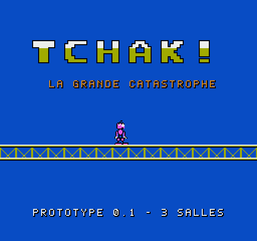

# TCHAK ! – La Grande Catastrophe · Manuel de jeu (Mondes 1 à 3)



## L'histoire

Dans la Fabrique des Choses Molles, tout rebondit, tout glisse, tout tombe. BIDULE, qui ne sait même pas sauter, possède un seul talent : se contracter d'un coup — **TCHAK !** — et secouer tout ce qui l'entoure. Il ne contrôle pas vraiment ce qui se passe ensuite… mais avec un peu d'observation, la catastrophe peut devenir un plan.

## Les commandes

| Bouton | Action |
|---|---|
| Croix GAUCHE/DROITE | marcher (maintenir pour courir) |
| Croix HAUT/BAS | monter / descendre une échelle |
| **B** | **TCHAK !** |
| **A** | actionner un levier (se placer devant) |
| START | pause |
| SELECT | recommencer la salle (sans perdre de vie) |

Au menu : HAUT/BAS pour choisir, START ou A pour valider.

## L'écran

```
♥05      MONDE 1-2               ♪00
        (messages)
```
À gauche vos vies, au centre le monde et la salle, à droite les chaussettes trouvées.

## Comment jouer

- Le TCHAK pousse les objets proches **à l'opposé de BIDULE**, et vers le haut. Plus l'objet est près, plus il part vite. Trop loin, rien ne bouge.
- Les **cibles** vertes s'allument quand un objet les percute. Les **plaques** s'enfoncent sous un poids suffisant — BIDULE est trop maigre pour en enfoncer une seul !
- Les **ressorts** projettent tout ce qui tombe dessus tout droit vers le haut, BIDULE compris. Dirigez-vous pendant le vol.
- Le **Trouillard** dort. Faites du bruit et il s'enfuit droit devant, en poussant tout ce qu'il rencontre.
- Les **cuves de gelée** rose sont dangereuses pour BIDULE. Un objet qui y tombe réapparaît à sa place.
- Chaque salle a plusieurs solutions. Les **chaussettes** récompensent les plus curieux.

## Le mot de passe

Il est affiché sur l'écran de présentation de chaque salle (« CODE : »). Au menu, choisissez MOT DE PASSE, puis GAUCHE/DROITE pour changer de case, HAUT/BAS pour changer de lettre, START pour valider.

Codes (sans chaussette) : 1-1 `BNFR` · 1-2 `FNFS` · 1-3 `DNFT` · 1-4 `SNFV` · 1-5 `RNFL` · 1-6 `VNFM` · 1-7 `TNFN` · 1-8 (boss) `MNFP`. Le code affiché en jeu tient aussi compte des chaussettes trouvées.

Monde 2 : 2-1 `LNFG` · 2-2 `PNFH` · 2-3 `NNFJ` · 2-4 `HNFK` · 2-5 `GNFB` · 2-6 `KNFC` · 2-7 `JNFD` · 2-8 `CNFF`.

Monde 3 : 3-1 `BNDR` · 3-2 `FNDS` · 3-3 `DNDT` · 3-4 `SNDV` · 3-5 `RNDL` · 3-6 `VNDM` · 3-7 `TNDN` · 3-8 `MNDP`.

## Conseils

- Si quelque chose tombe dans la gelée, ce n'est pas grave : observez, il reviendra.
- Le TCHAK part une fraction de seconde après l'appui : anticipez ce qui bouge.
- Avant d'effrayer quelqu'un, regardez où il va courir.
- BIDULE est tout maigre : il ne pèse pas assez pour enfoncer une plaque tout seul.
- Le Roi du Rebond ne se bat pas : il se piège. Observez où il retombe.

## La maison qui n'en fait qu'à sa tête (Monde 2)

Dans la maison, le TCHAK ne pousse pas les meubles : il les vexe, les intrigue ou les réveille.

- **Le fauteuil grognon** fonce vers vous dès qu'il entend un TCHAK, jusqu'au premier obstacle. Gare à la tête !
- **La lampe curieuse** vient voir exactement là où vous avez fait TCHAK.
- **La commode paresseuse** fait la sourde oreille : il faut insister (trois TCHAK de suite), et elle s'en va de l'autre côté.
- **Le coffre gourmand** ne s'intéresse qu'aux biscuits : il va les manger là où ils tombent.
- Certaines portes ont **trois serrures** : chaque plaque ou cible ne compte qu'une fois.
- **Madame Armoire** avale ce qu'on lui lance et le recrache par-dessus elle, vers l'arrière. Un TCHAK tout près la fait se retourner.

## L'usine des catastrophes (Monde 3)

- Les **pistons** frappent quand un mécanisme les déclenche : tout ce qui est juste devant eux est projeté. Pensez à mettre quelque chose devant **avant**.
- **Le Copieur** fait exactement les mêmes pas que vous (s'il est bloqué, il reste bloqué). Un TCHAK le fait passer en **miroir** : il fait l'inverse. Et inversement.
- **Le Machinal** patrouille et appuie sur tout ce qu'il croise. Un TCHAK le fige un moment, puis il repart dans l'autre sens.
- **Le Grand Dérangé** inverse les convoyeurs quand ça lui chante et ne tombe jamais tout seul. Étourdi par un TCHAK, il se laisse emporter… Attention à ne pas vous laisser emporter vous-même !

## Où jouer

Ouvrez `dist/tchak.nes` avec un émulateur NES (Mesen, FCEUX, Nestopia…). La ROM utilise le mapper 1 (MMC1) ; elle n'a pas encore été essayée sur une vraie console.
